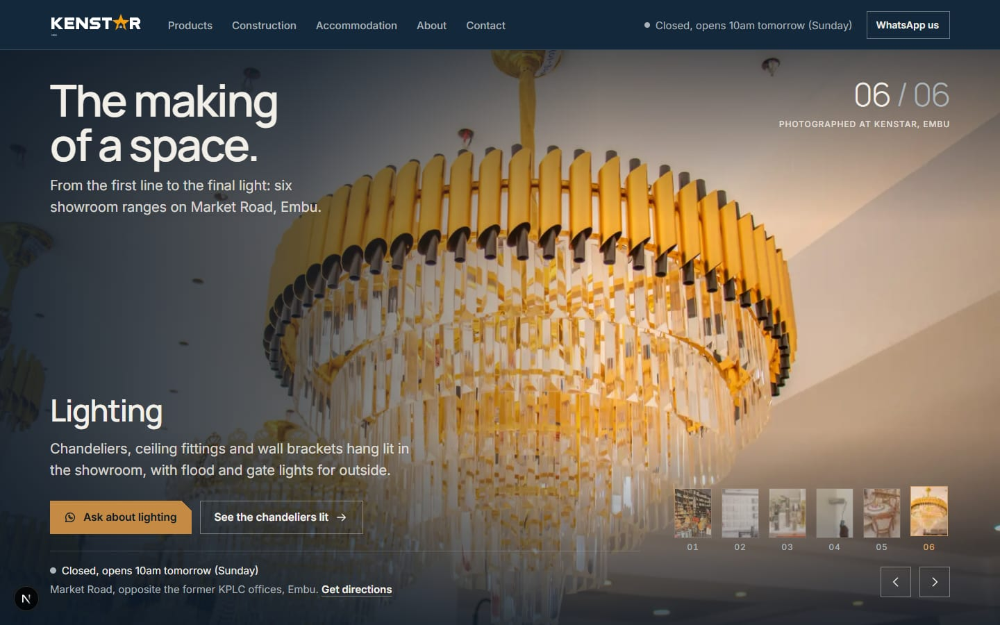
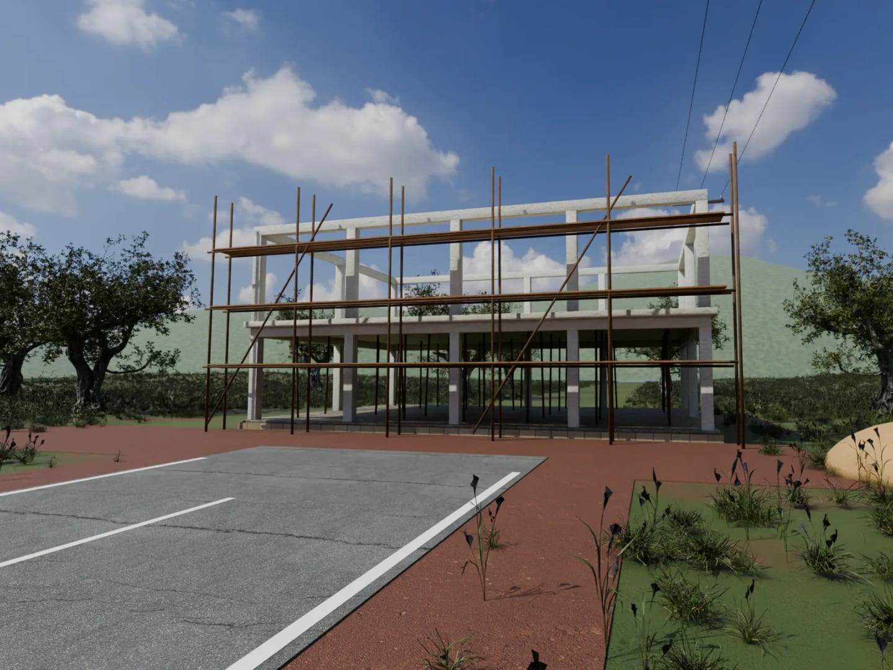
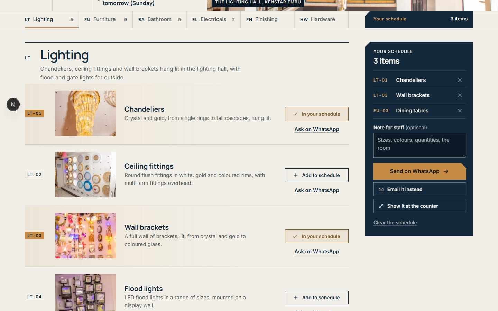
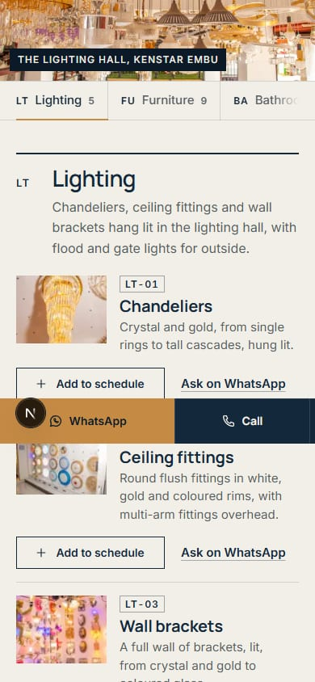
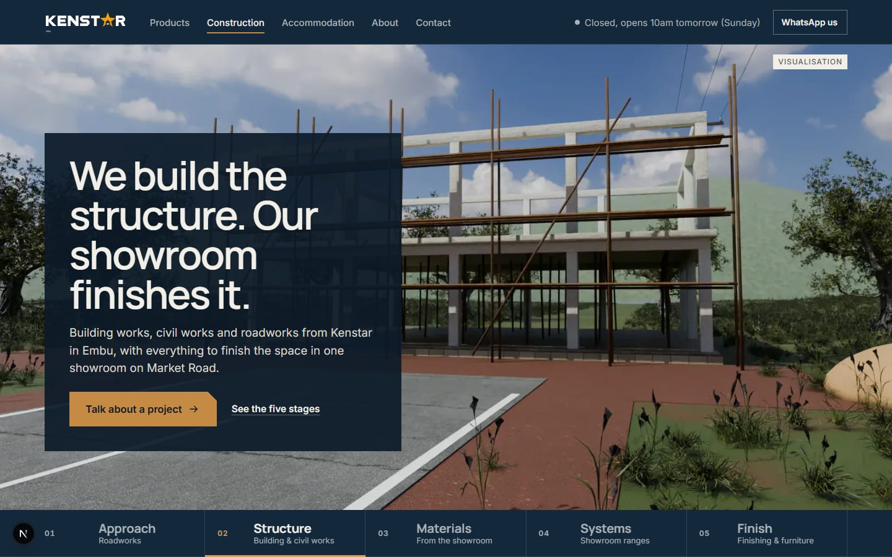
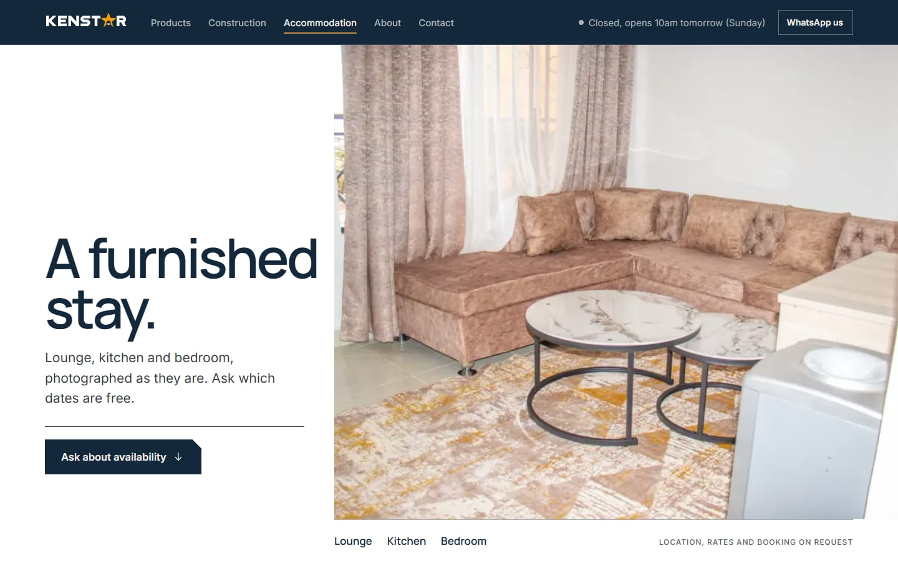
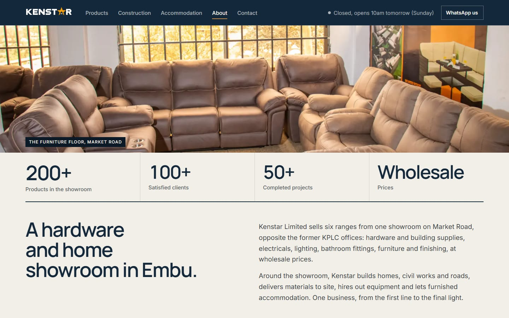
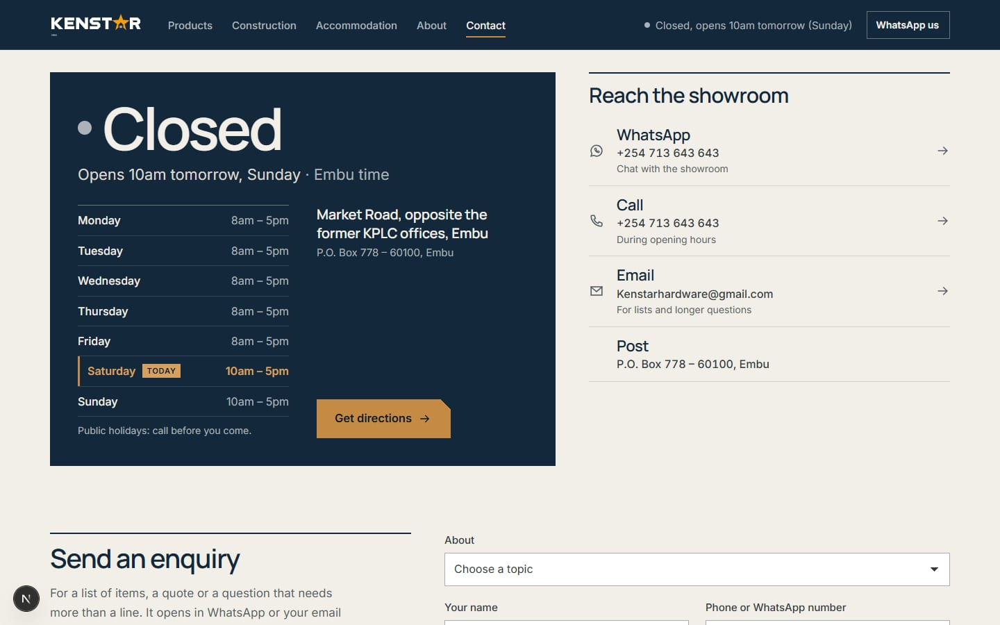
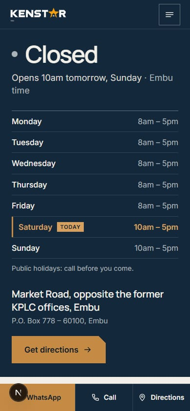

# Kenstar Limited: The making of a space

**A brand and catalogue website for a hardware and home showroom in Embu, Kenya.**

**Live site: [hardware.silvavalley.co.ke](https://hardware.silvavalley.co.ke)**



Kenstar Limited is best known in Embu for its showroom on Market Road. Its six ranges run from building supplies to crystal chandeliers. The business also builds houses, civil works and roads, delivers materials, hires out equipment and lets furnished accommodation.

This project replaces Kenstar's old WordPress site with a new brand built around one idea:

> **The making of a space: from the first line to the final light.**

Every page treats construction as a way of telling the story, but the showroom stays the commercial heart. The site has three jobs: help people find the products, bring them to the showroom in Embu, and start useful conversations on WhatsApp, by phone or by email.

---

## At a glance

| | |
|---|---|
| **Role** | Art direction, UX, design system, front-end engineering, 3D rendering pipeline |
| **Stack** | Next.js 16 (App Router), React 19, TypeScript, Tailwind CSS 4, GSAP, Blender 5.3 (Cycles), sharp |
| **Pages** | Home, Products, Construction, Accommodation, About, Contact |
| **Content rules** | Kenstar's own photography; no invented prices, stock, products, clients or claims |
| **Commerce model** | Browse the catalogue, then enquire. No cart, no checkout, no accounts |

---

## Highlights

### 1. A homepage journey rendered frame by frame in Blender



The homepage walks the visitor through six chapters: **Approach, Structure, Materials, Systems, Finish, Arrival**. It goes from a new road to a furnished room lit at night.

The site runs no 3D in the browser. Every frame is **pre-rendered in Blender** from a scene built entirely in Python (`render/journey/`), using CC0 models and textures from Poly Haven. At each chapter the scroll-driven canvas player:

- walks the camera between stops on rendered frames;
- draws the chapter's new work as a **vector wireframe**, traced from the same camera with Blender's Freestyle;
- fills it in with the photoreal render.

**Field Notes** pin real Kenstar photographs to the objects in the scene. With reduced motion turned on, visitors get still frames with their notes instead.

### 2. Products as a finishes schedule, not a shop



Kenstar doesn't sell online, so a cart would be a lie. The catalogue is instead a **finishes schedule**: ruled lines, each with a code (LT-01, FU-04 and so on), a real photograph from the showroom and one honest line about what that photograph shows.

- **Tick lines into "Your schedule".** It is kept on the device, so it survives a reload or a closed tab.
- **Send it in one go.** The schedule becomes a single WhatsApp message or email, with codes, names and a note for staff.
- **Show it at the counter.** A full-screen view lists each item large, with its photo and the date, for the visitor to hold up in the shop.
- **On phones,** a bottom bar replaces the usual action bar once the schedule has items. Its brass WhatsApp button then sends the schedule, not a blank message.

<p>
  
</p>

### 3. Construction: the journey's stages as the service list



The page tells one story: *"We build the structure. Our showroom finishes it."*

- **Stage strip:** five stages, from Approach to Finish. The strip sticks under the header and lights the stage in view.
- **Real proof:** each stage shows Kenstar's own project photographs. Renders always carry the label "Visualisation".
- **A way back to the showroom:** every stage links into the showroom range that supplies it, and the page ends with a visit to the showroom, not just a form.

### 4. Accommodation as a magazine spread



The furnished stay is set like an interiors feature. A large headline sits in open white, the photograph crosses the gutter, and each room follows as a plate.

Location, rates and booking aren't confirmed yet, so the page says so plainly under **"Still to be confirmed"**. The form asks about availability rather than pretending to book anything.

### 5. About as a ledger of facts



There's no founder story, timeline or team grid, because none of that is published. Instead, a showroom photograph sits above a title block of the four figures Kenstar confirmed: **200+ products, 100+ satisfied clients, 50+ completed projects, wholesale prices**. A ruled index of everything Kenstar does follows, with retail first.

### 6. Contact as the sign on the shop door



A dark door-sign panel works out **open or closed live, in Embu time** (Africa/Nairobi). It shows:

- when the shop closes, or when it opens next;
- in the last 90 minutes, how many minutes are left;
- the week's hours, with today marked.

Next to it, WhatsApp, Call, Email and Post appear as ruled rows with the real details. The page embeds no third-party map.

<p>
  
</p>

---

## The design system: "Architectural Editorial Luxury"

The approved system is documented in [`DESIGN.md`](DESIGN.md), with the original proposal in [`docs/design-system/proposal.html`](docs/design-system/proposal.html). Its colours are sampled from the showroom itself:

| Token | Value | Role |
|---|---|---|
| Midnight | `#14283B` | Header, door sign, docked schedule, enquiry bands |
| Limestone | `#F2EFE8` | The drawing sheet most pages sit on |
| Graphite | `#343A40` | Text and hairline rules |
| Brass | `#C58B45` | Selection and the one primary action in view |
| Olive | `#697B68` / `#93A691` | "Open now" |
| Star gold | `#F59E0B` | The logo's star, and nothing else |

- **Type:** Manrope (600/700) for anything large, Inter for anything read or measured. Small capital labels carry codes and figures only, never eyebrows.
- **The cut corner:** a 45° cut, taken from the chamfers in the KENST★R wordmark. It marks the one primary action per view, and the midnight "Field Note" plates.
- **Motion:** only three experiences animate: the logo loader, the showroom carousel and the journey. Everywhere else, motion is feedback.

---

## How it was designed

The design followed a structured workflow, one page at a time:

1. **Choose the structure.** For each page, three or four structural sketches were compared side by side. The chosen sketch became that page's **direction contract**: its thesis, the world it lives in, its first viewport and its signature interaction. See `.impeccable/surfaces/`.
2. **Build in code** against that contract, using only confirmed facts and Kenstar's own photographs.
3. **Critique in two isolated passes.** One was a design review with heuristic scoring. The other was an automated anti-pattern detector, with a browser overlay at desktop and phone widths.
4. **Polish.** Every P1 and P2 issue was fixed, then each page was re-measured at 390, 1024 and 1440 px.

| Page | First critique | After polish |
|---|---|---|
| Products | 24/40 | All P1/P2 issues fixed |
| Construction | 27/40 | All P1/P2 issues fixed |
| Accommodation | 28/40 | All P1/P2 issues fixed |
| About | 35/40 | All P1/P2 issues fixed |
| Contact | 31/40 | All P1/P2 issues fixed |

### Truth over polish

- **Nothing invented.** No prices, stock levels, product names, testimonials, client names or years in business, because none have been confirmed.
- **Stand-ins are labelled.** Where Kenstar has no photography yet (hardware and finishing), free stock images carry the label "Illustrative photo". Renders carry the label "Visualisation".
- **Every image's source is recorded.** All 134 shipping images carry an embedded note of where they came from, and [`docs/image-sources.md`](docs/image-sources.md) lists them.

---

## Engineering notes

- **Next.js 16 App Router** with Cache Components. Server components render each page; client components handle only the live parts: the schedule, the door sign, the stage strip and the forms.
- **A schedule with no backend:** a small `useSyncExternalStore` store. Memory is the source of truth and localStorage is a best-effort copy, so blocked storage (private windows, previews) never breaks the page. Open tabs stay in sync through `storage` events.
- **Enquiries without a server:** the shared `EnquiryForm` checks its inputs (dates, guest counts, phone numbers) and opens WhatsApp or the visitor's email app with the message written. If a pop-up blocker stops WhatsApp opening, it opens in the same tab instead.
- **Live opening hours:** times are worked out with `Intl.DateTimeFormat` in `Africa/Nairobi`. The server renders the plain hours, and the page switches to live status once it loads, so nothing on the page is wrong before then.
- **Accessibility:**
  - native `<dialog>` for the phone sheet and the counter view;
  - screen readers hear each schedule change;
  - focus moves to the next sensible control after a line is removed or the schedule is cleared, and the clear can be undone;
  - visible focus rings drawn from the palette;
  - reduced-motion stills for the journey.
- **Images:** `next/image` throughout, with responsive `sizes`. Journey frames are WebP, encoded with sharp.

### The render pipeline

```bash
node render/fetch-assets.mjs     # CC0 models, textures and skies from Poly Haven into render/assets/
bash render/render-all.sh        # Blender 5.3 Cycles: stills, walks, Freestyle line passes
node render/encode.mjs           # WebP frames, simplified stroke JSON, and the frames.json manifest
```

See [`docs/journey-render-spec.md`](docs/journey-render-spec.md) for cameras, frame sizes and per-chapter jobs.

---

## Running it locally

Requires Node 20+ and pnpm.

```bash
pnpm install
```

```bash
pnpm dev
```

Then open http://localhost:3000.

```bash
pnpm build && pnpm start
```

### Project structure

```
app/
  page.tsx                 Home: logo loader, showroom carousel, the journey
  products/                The finishes schedule
  construction/            Structure to finish
  accommodation/           The magazine spread
  about/                   The ledger
  contact/                 The door sign
  _components/             Header, footer, action bar, enquiry form, journey, loader
  _content/                Facts and copy: site, products, construction, stay, about
render/                    Blender scene (Python) and asset/encode scripts
docs/                      Design system, render spec, image sources, briefs
public/images, public/journey   Photography and rendered frames
```

---

## Credits

- **Photography:** Kenstar Limited's own June 2026 showroom shoot, its project photographs and its accommodation photographs, used with permission.
- **3D assets:** CC0 models, textures and HDRIs from [Poly Haven](https://polyhaven.com).
- **Stand-in images:** free photographs from Unsplash, labelled "Illustrative photo" on the site until Kenstar's own arrive.
- **Type:** Manrope and Inter, via Google Fonts.

The brand, the photography and the business content belong to Kenstar Limited.
